This project began with a conversation at my graduation ceremony. I had been working with
Meshtastic, the open-source firmware that turns inexpensive LoRa transceivers into a
self-forming mesh capable of relaying text without any supporting infrastructure, and I
had been considering what such a mesh would be worth in terrain where cellular service does
not reach. Another graduate described the directed-study mechanism to me and suggested I
write to a professor about the idea. I did, and the result was a summer of work under
Professor Basagni.

## Framing the problem

The premise was narrow and testable. Hikers are reported missing in the White Mountains
every year, frequently in terrain where a handset is inert. A network of solar-powered
relays sited on ridgelines could, in principle, carry a distress message out of that
terrain. The question worth answering was not whether such a network is conceivable, but
whether its behaviour can be predicted with enough confidence to justify building one.

I had already assembled the first nodes: 3D-printed enclosures, Meshtastic firmware,
batteries and antennas, carried up trails to observe their behaviour in situ. Those
deployments were sufficient to establish that the hardware functioned and wholly
insufficient to establish anything quantitative.

The study therefore organised itself around AIRMap, a coverage-prediction pipeline I could
direct at the problem, and around a single objective: take a model that predicts radio
coverage, carry instrumented radios into the terrain it describes, and determine whether
the model's predictions survive contact with the ground.

## Field trials and instrumentation

The trial hikes produced the measurement record. A Raspberry Pi collector logged telemetry
continuously, capturing RSSI, SNR and GNSS position for every received packet, with a
Garmin receiver running in parallel as an independent one-hertz position track so that the
mesh could not serve as its own ground truth.

The subsequent comparison of prediction against measurement failed, and the manner of its
failure proved to be the most productive result of the early work.

## A propagation model built for a different environment

Free-space path loss presumes an unobstructed path between two antennas and penalises
distance alone. That assumption is defensible in an urban setting, where the dominant
effects are structures and reflections that can be absorbed into a clutter term.

Mountainous terrain does not behave as clutter. The terrain is itself the obstruction.

Link prediction was accordingly rebuilt on **Longley–Rice ITM** over USGS 3DEP elevation
data, which traverses the actual terrain profile between two endpoints and assesses loss
against the intervening ground. Both models were then evaluated over an identical set of
candidate sites.

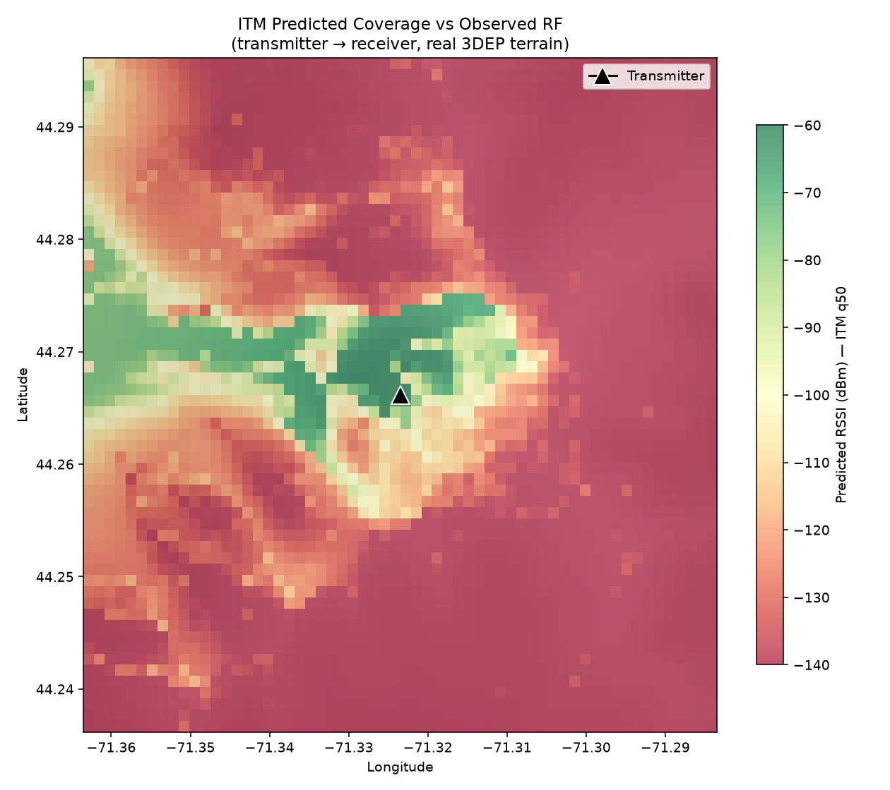

*Predicted received signal from a single transmitter over real terrain. The green corridor
follows the ridgeline. The deep red regions denote locations at which a receiver may sit
under open sky and remain unreachable.*

The outcome contradicted the prevailing intuition, including my own, and it is worth
stating precisely.

I had assumed that clearing the treeline constituted the decisive advantage: open sky, an
unobstructed path, and consequently long links. The free-space screen concurred, rating the
treeline-to-summit links as strong.

Longley–Rice over the measured elevation profile predicts those same links **blocked**.
Terrain rises as much as **53 metres above the direct ray** between the Ammonoosuc relay
and the summit, yielding −132.2 dBm against an assumed −131 dBm sensitivity floor.
Conversely, the below-treeline valley links, which I had treated as the difficult case,
are predicted clear and strong at −76.6 and −74.1 dBm. The worst-case disagreement between
the two models on a single summit-facing path is **62.3 dB**.

The mountain on which the transmitter stands is the structure obstructing it. A summit cone
is convex, and it shadows its own flanks.

At Moosilauke the terrain model produces a signature free-space physics cannot reproduce
under any parameterisation. Predicted signal above the treeline is **non-monotonic in
distance**: −92 dBm between 0.5 and 1 km, declining to −114 dBm within the terrain-shadowed
band, and recovering to −73 dBm between 2 and 4 km. A received signal that strengthens with
increasing distance is a shape only terrain geometry can generate.

That result established the necessity of the terrain-aware approach.

## Simulator design

Determining which links are feasible establishes nothing about whether the network remains
operational in February. A relay that exhausts its battery in January continues to appear
on the map from which a search team plans.

The question therefore required simulation at the scale of years rather than links. I
evaluated ns-3, the conventional choice, and implemented a purpose-specific simulator
instead. ns-3 is a mature protocol and packet-network framework, and it models none of the
quantities that govern this problem: solar harvest against a per-site terrain horizon mask,
battery depletion and recovery, seasonal weather, hiker arrivals along real trail geometry,
and kiosk rental logistics.

The simulator was consequently implemented twice.

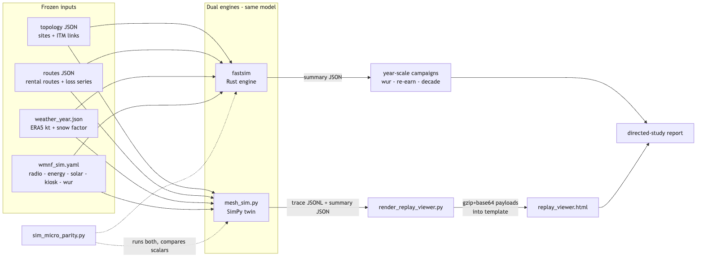

*A Python/SimPy reference implementation and a Rust release build, driven by a single
frozen input set. A parity harness executes both against an identical micro-scenario and
compares scalar outputs. No quantity is treated as a result until both engines produce it.*

The model comprises 457 sites: ridge relays, hut and shelter nodes, trailhead kiosks that
issue radios to walkers, and the walkers themselves traversing real trail geometry. Weather
is drawn from an ERA5 reanalysis year. Solar harvest is computed against each site's own
horizon. Emergencies occur stochastically, and the resulting messages must find a path out.
Nine routing and duty-cycle modes were evaluated at five seeds each, with hash-locked
inputs such that every run reproduces exactly.

## The Dolomites

In June I travelled to the Brenta Dolomites alone, and I took the equipment with me.

I carried the nodes and recorded readings on the approaches, in the vicinity of Rifugio
Tuckett, and above it. None of that data appears in the report. The measurements were
opportunistic and uncontrolled, lacking beacon discipline and sequence-number denominators,
which is precisely the standard the calibration gate exists to enforce. They would not have
passed it, and I did not attempt to present them as though they would.

The observed difference was nonetheless substantial. Above the treeline, over open rock,
links held at ranges that had been failing consistently in New Hampshire forest.

This appeared to contradict my own terrain model. The reconciliation lies in a term the
model does not contain.

Longley–Rice accounts for terrain. It does not account for vegetation. My own report states
this explicitly in the same passage that reports the strong valley links: both paths run
essentially entirely below the treeline, and *ITM excludes canopy loss, which must be
budgeted separately*. The model systematically underestimates loss on a forested link,
because it implicitly treats the forest as absent.

The two results are therefore consistent. For a specific summit-facing chord, the convex
cone of the mountain obstructs the path, and no degree of overhead clearance alters that;
this is geometry, and ITM represents it correctly. Across every path not geometrically
obstructed, however, clearing the treeline removes an attenuation term of material
magnitude at these frequencies, and that term is absent from every figure I had computed.

Vegetation attenuation in this band is a well-characterised quantity with a dedicated ITU
recommendation, ITU-R P.833. Establishing a measured value for New Hampshire spruce and fir
and re-running the topology with canopy loss included is the obvious next contribution.

What the Dolomites yielded is an observation rather than evidence. Its value lies in
identifying which experiment to conduct.

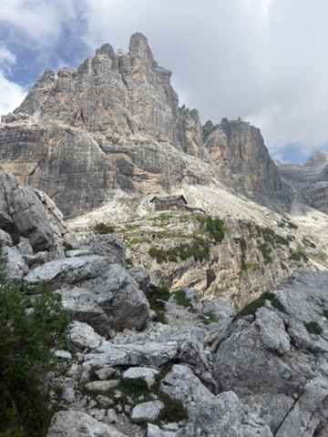

*Rifugio Tuckett, approximately 2,270 m. The hut is the small rectangle left of centre.
Every pale surface in this frame is loose rock.*

## Thirty minutes above the hut

On the morning following my arrival at Tuckett I departed on the only path ascending from
the hut.

Thirty minutes along, what the map designated a trail had become loose rock on a steep
ledge, and shortly afterwards it ceased to be a trail at all. The path had eroded out
entirely. I lost sight of the waymarks for approximately fifteen steps.

Fifteen steps proved sufficient. I passed from precarious to unsupported: no footholds, no
handholds, and every hold I located detaching under load. The substrate was dust containing
rock, and the rock was itself substantially dust.

I then began to slide, having not elected to.

I recall shouting for help. I recall observing my own fingers open, not as a decision but
as an event I was witnessing, and registering with considerable detachment the question of
whether I was in fact tired enough to let go.

My body resolved the question before I did.

I descended sixty to seventy feet in increments of five to fifteen feet. The final
increments were more controlled than the first, which is the sole reason this account
exists.

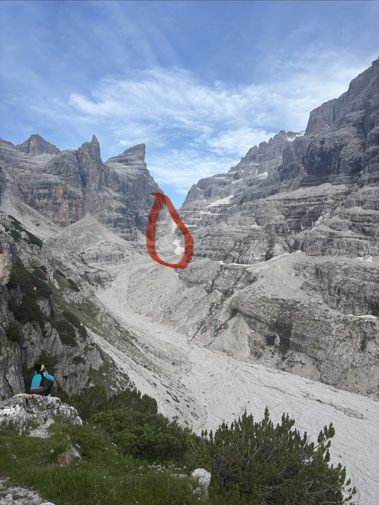

*Circled: the gully from which I emerged. The circle encloses approximately twice the
distance actually travelled. For scale, note the hiker seated on the rock at lower left and
the scree fan descending the centre of the frame, several hundred metres from top to
bottom.*

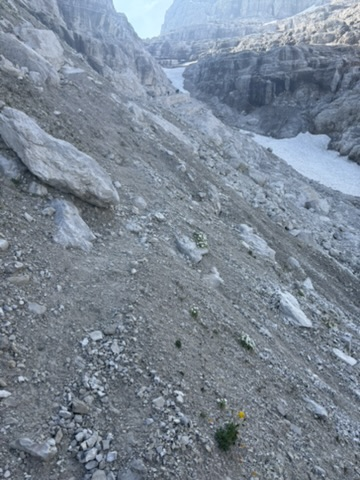

*The substrate. Nothing in this frame bears weight.*

A helicopter was summoned. I did not summon it; I had no means of doing so and was in no
condition to consider it. It was subsequently stood down once I had reached ground on which
I could stand upright unaided. The descent required approximately thirty-five minutes.

## That evening

I was unaware throughout that I was visible to anyone. Two separate parties had seen it.

The helicopter was called by someone already travelling toward me, whom I never met. The
second party had watched the sequence from the opposite side of the valley and was moving
in the direction I was headed. The two passed one another on the trail.

What they had not seen was the end of it. They watched the fall until I passed out of their
line of sight, and from that point they had no information at all. They did not know whether
I had reached the bottom under my own power or whether they had just watched a stranger die
on a mountain. Several of them, I learned that evening, had assumed the latter and had been
in tears over it.

I walked into the hut that night. One of them crossed the room, reached me at something
close to a run, and embraced me, and he was crying when he did it.

We had a beer together afterwards, and by then it was funny.

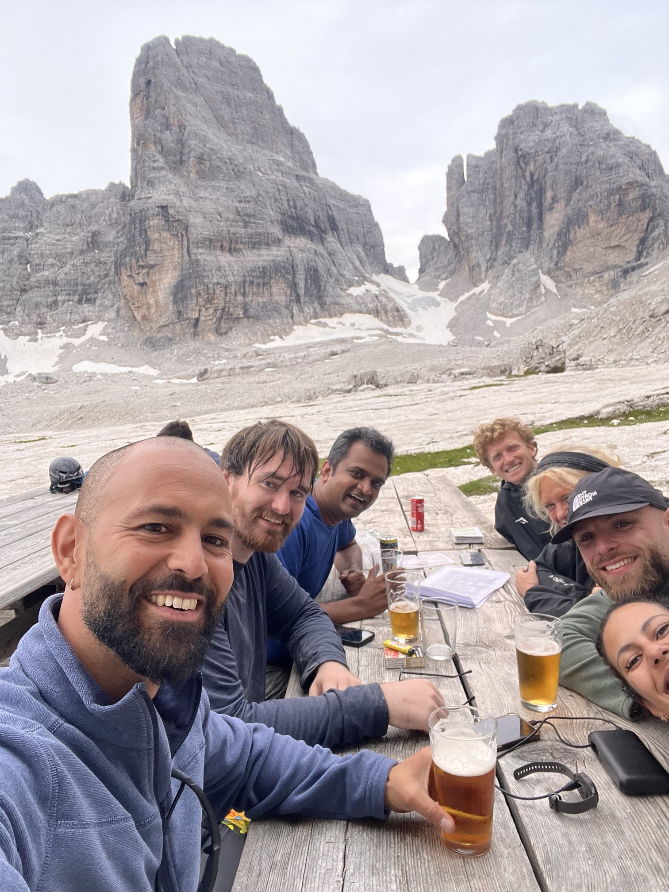

*Towers behind, beer in front, and the people who had watched the descent from across the
valley.*

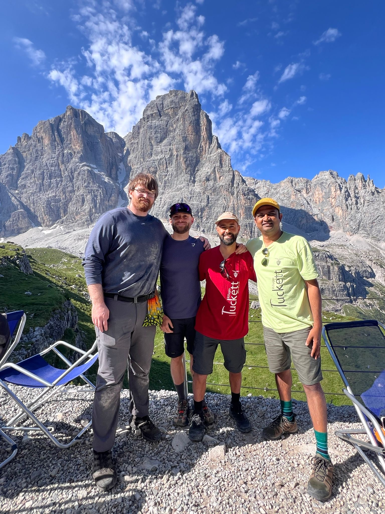

## Incentives, the following morning

Among them was Ragupathy Venkatachalam.

He is Professor of Economics at Goldsmiths, University of London, holds a doctorate from
the University of Trento, and works at the interface between computation and economics:
computable economics, agent-based computational modelling, endogenous and nonlinear
business cycle theory, and the classical behavioural economics developed in the tradition
of Herbert Simon. He has edited two Springer volumes in the field, *Complex Systems
Modeling and Simulation in Economics and Finance* (2018) and *Artificial Intelligence,
Learning and Computation in Economics and Finance* (2023), and is an associate editor of
*Economia Politica*. In October 2025 Goldsmiths announced his election as a Foreign Member
of the Istituto Lombardo – Accademia di Scienze e Lettere, the Milanese academy founded in
1797 whose past members include Alessandro Volta and four Italian Nobel laureates.

The person I happened to be walking out with, in other words, builds formal models of
systems in which many independent agents act in their own interest, which is the apparatus
I was about to discover I needed.

The following morning we walked together and spent it discussing game theory: incentives,
goal states, and the behaviour of systems in which every participant optimises
independently while the system as a whole is still required to function. At the time this
was trail conversation and bore no relation to my project.

It acquired a relation to my project on the flight home.

Every relay in the network is individually better served by sleeping. Listening is the
dominant drain; a node that sleeps survives the winter and a node that listens does not.
The network nevertheless exists only because a sufficient number remain awake to forward
**another party's** emergency traffic. Each relay's individual optimum is precisely the
behaviour that eliminates the service.

That is not a routing problem. It is an incentive structure, and I had been varying the
wrong parameter.

## The governing parameters

The nine-mode policy comparison that followed answered the question I had been posing for
six months in terms I had not anticipated.

I compared five materially distinct always-on routing strategies: flooding, shortest-hop,
ETX link-quality, energy-aware, and load-balanced cost trees. Annual node depletions across
all five fell within a **0.3% band**, from 29,164 to 29,234 per year. Four of the five
returned identical fleet availability and identical dark-site counts.

Holding routing fixed and varying only the duty and wake policy moves depletions by a
factor of **5.5 to 24**. Fleet availability moves from approximately 54% to between 90 and
96%.

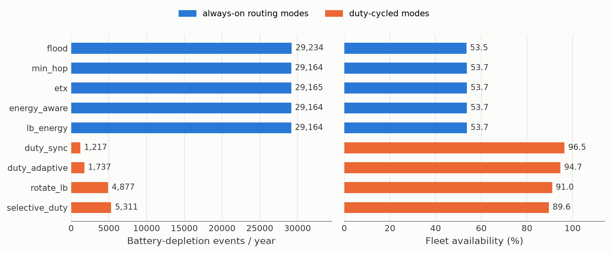

*Nine modes, one simulated year each. The five blue bars represent distinct routing
algorithms and are indistinguishable from one another. The four orange bars differ only in
when a node listens.*

The mechanism is straightforward: 68 mA with the receiver enabled, 12 mA asleep. A node's
behaviour while it is **not** forwarding governs its survival far more strongly than the
topology its packets follow.

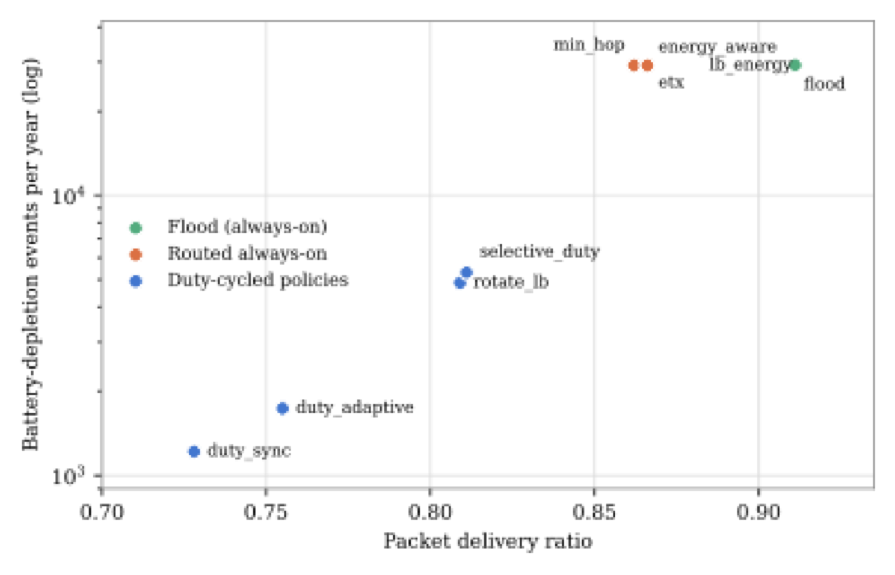

*The same nine modes expressed as a frontier. The ordinate is logarithmic; the routing
cluster sits an order of magnitude above the duty-cycled policies.*

The canonical hardware remedy is a wake-up receiver, in which the main radio sleeps behind a
micro-power detector that listens for a wake chirp. I pre-registered that study with
falsifiable criteria frozen prior to execution, and it failed for a measurable reason. At a
realistic **40 dB** sensitivity margin between the wake detector and the main radio,
**40.1% of routing-eligible links cannot carry the wake chirp at all**, and a median of 89
of 457 sites lose every wake-feasible path to a gateway. The architecture constructs a
network incapable of waking itself.

Reducing idle receive current directly is effective where the wake-up architecture is not.
On the same 37 Wh battery and 6 W panel, lowering idle listen current to approximately
10 mA raises modeled availability to 99.8%; at nRF52-class currents of 2 to 5 mA the fleet
loses no node across the full year. For comparison, quadrupling battery capacity alone
moves availability from 53.5% to 57.2%, because winter harvest is the binding constraint
and additional storage has nothing to contribute.

Identical battery, identical panel, quieter receiver. The receiver outperforms a fourfold
increase in the solar kit, and by a substantial margin.

That conclusion was not actionable. No component existed at the required sensitivity, which
left duty cycling as the only available lever, and duty cycling carries a cost.

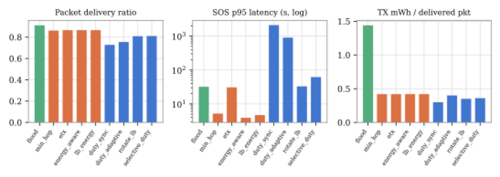

*The central panel is logarithmic. The policy yielding the greatest survivability in the
study places 95th-percentile emergency latency in the thousands of seconds.*

Uniform low-duty cycling produces the largest survivability gain in the study, a factor of
24. It also raises 95th-percentile emergency latency to **35 minutes**.

Thirty-five minutes is approximately the interval I spent descending that slope.

## The component that did not exist

Three weeks ago it was published.

**Longan** (SenSys '26; Li, Chen and Li, City University of Hong Kong) is a LoRa receiver
sustaining kilometre-scale links at approximately **1 mW**, against the up to **42.4 mW** a
commercial SX1278 consumes to remain listening in always-on Class C. Measured continuous
detection is **1.16 mW**, a **36× reduction** relative to COTS LoRa.

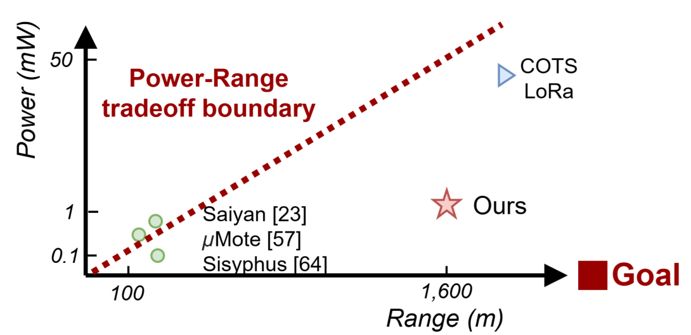

*Figure 1 from the Longan paper, reproduced under CC BY 4.0. Sub-milliwatt receivers had
reached a few hundred metres; kilometre-range receivers had cost tens of milliwatts. The
star denotes the paper's contribution.*

The figure of greatest consequence to this work is not the power consumption. Longan
preserves sensitivity **within 3 to 13 dB** of commercial devices. That is the 40 dB margin
which disabled the wake-up architecture in my study, measured at a value at which it does
not disable it.

I accordingly re-ran the sweeps: identical frozen inputs, identical 457 nodes, identical
365-day horizon, with a Longan-class receive path in the energy model. The simulator first
reproduced four of my published energy-sweep rows **byte for byte**, with SHA-256 digests
identical to those recorded in the original run manifest, before computing anything new.

The resulting row records **zero depletions across every seed, 100% fleet availability, a
delivery ratio of 0.833, and 95th-percentile emergency latency of approximately three
seconds.**

The comparison worth drawing is against the uniform low-duty policy, which had previously
been the only route to survivability of that order and which placed the same latency figure
at thirty-five minutes. The Longan-class configuration reaches three seconds while duty
cycling nothing at all.

Furthermore, the tradeoff does not merely become less expensive; it inverts. Reducing listen
current does not affect sleep current, which remains at 12 mA, with the consequence that at
a Longan-class receive path *sleeping costs approximately 44 times more than listening*.
Every duty cycle below 100% leaves a node worse off. The incentive structure that organised
the second half of this project ceases to exist, because the individual optimum and the
collective optimum converge on the same behaviour: remain awake.

This relocates the open question. Once a receiver listens at sub-milliamp current, sleep
current becomes the binding parameter, and it is the one I have not measured.

That is the bench work, and it is next.

---

**Project code, data and sweeps:**
<https://github.com/edoherty2017/resilient-emergency-manets-final>

**The Longan paper:** Mingzhe Li, Tao Chen and Zhenjiang Li, *Longan: Ultra-Low-Power,
Long-Range LoRa Receiver for LPWANs*, SenSys '26.
[DOI](https://doi.org/10.1145/3774906.3802753) ·
[author PDF](https://www.cs.cityu.edu.hk/~zhenjili/2026-SenSys-Longan.pdf) ·
[slides](https://www.cs.cityu.edu.hk/~zhenjili/2026-SenSys-Longan-Slides.pdf)
