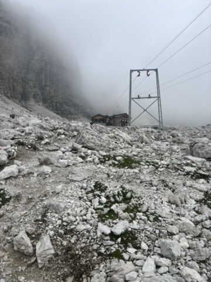

*Rifugio Tuckett, the Brenta Dolomites, June 2026 — and a year-scale simulation of a
wilderness rescue mesh.*

*From a faculty-advised directed study at Northeastern (CS 5976). The simulation figures
below are modeled results. The trip to Italy was a holiday.*

*Rifugio Tuckett, about 2,270 m. The hut is the small rectangle left of centre.
Everything pale in this frame is loose rock.*

## The question

If you scatter solar-powered radios across a mountain range so that a lost hiker can
call for help, the interesting question is not whether the network works on the day you
install it. It is whether it is still alive in February.

A relay that dies in winter is worse than no relay, because the map still shows it.

So I built a discrete-event simulator in two independent engines — a Python/SimPy
reference and a Rust release build, cross-validated against each other on a shared
micro-scenario — and ran a 457-node Meshtastic-style network for 365 simulated days at
a time. Radios, batteries, solar panels, reanalysis weather, hikers, emergencies.
Nine routing and duty-cycle modes, five seeds each, hash-locked inputs so every run
reproduces.

## The first result: routing barely matters

I compared five materially different always-on routing strategies. Flooding.
Shortest-hop. ETX link-quality. Energy-aware. Load-balanced cost trees.

Annual node depletions across all five sat inside a **0.3% band** — 29,164 to 29,234
deaths per year. Four of the five returned *identical* fleet availability and
*identical* dark-site counts.

Now hold the routing fixed and change the duty and wake policy instead. Depletions move
**5.5 to 24 times**. Fleet availability moves from roughly 54% to between 90 and 96%.

The mechanism is unglamorous. The energy budget is governed by idle listening: 68 mA
with the receiver on, 12 mA asleep. What a node does while it is *not* forwarding
dominates its survival far more than which tree its packets follow.

Which reorders the design priorities for this kind of network. Wake architecture first.
Routing second.

## The second result: the simple answer beat the clever one

If idle listening is the problem, the textbook hardware answer is a wake-up receiver:
let the main radio sleep completely behind a micro-power detector that listens for a
wake chirp and boots the real radio when it hears one.

I pre-registered that study. Falsifiable criteria frozen before any run, implemented in
both engines with parity verified, executed as three experiments. I set the bar high on
purpose: the competitor was not the stock 68 mA fleet but the *ideal-hardware null* —
identical always-on routing on 2 mA nRF52-class silicon.

The answer came back decisive, and it was the opposite of what the architecture
promised. Every sensitivity margin produced roughly 488 depletions a year from
boot-energy cycling at marginal sites. Even the physically unrealizable zero-delta arm —
a wake receiver as sensitive as the main radio, which cannot exist — fell below the null
on delivery ratio.

A static link census explained why. At a realistic 40 dB sensitivity margin, **40.1% of
routing-eligible directed links cannot carry the wake chirp at all**, and a median of 89
of 457 sites lose every wake-feasible path to a gateway. The clever architecture builds a
network that cannot wake itself up.

The conclusion I wrote at the time still seems right to me:

> The question a wake-up radio answers — how to listen without paying 68 mA — is
> answered better by silicon that listens at 2 mA than by a second radio that cannot
> hear.

Freezing the criteria first is what makes that conclusion worth anything. It is the
cleanest result in the project.

## What you would actually buy

My advisor asked the question that turns a finding into engineering: what would you have
to purchase? That became an appendix.

Sweeping the energy kit while holding the stock radio, availability is panel-dominated.
Quadrupling the battery alone moves fleet availability from 53.5% to 57.2%, because
winter harvest is binding and storage has nothing to give. Reaching the 90–95% band
takes roughly four times the battery *and* four times the panel.

Sweeping idle receive current instead, on the stock 37 Wh battery and 6 W panel: at
about 10 mA, modeled availability reaches 99.8%. At nRF52-class 2–5 mA, the fleet loses
no node all year.

Same battery. Same panel. The quieter receiver beats buying four times the solar kit,
and lands higher.

*The approach on a grey day. The hut is the dark shape under the wall; the pylon carries
the supply cableway. This is what the ground is made of here — white rubble, ankle deep,
moving underfoot.*

## Incentives and goal states, on the way up

In June I went to the Brenta Dolomites. Not for the project. I had been staring at solar
harvest curves for months and wanted to be in actual mountains instead of modeled ones.

I spent several hours of trail walking with a man with a doctorate in economics, talking
about game theory — about incentives, and about goal states, and what happens when every
participant in a system optimises for itself and the system still has to work.

I did not connect it to the simulator at the time. I was on holiday.

## Thirty minutes above the hut

The next morning I left the hut on the only path heading up.

Thirty minutes along, what the map called a trail was loose rock on a steep ledge, and
then it was not a trail at all. The path had eroded out completely. I lost sight of the
blazes for about fifteen steps.

Fifteen steps was enough. I went from precarious to nothing: no footholds, no handholds,
and every hold I did find came away in my hand. It was dust with rocks in it, and the
rocks were also dust.

Then I was sliding, and I had not chosen to.

I remember shouting for help. I remember watching my own fingers open — not deciding to
let go, but observing it happen, and thinking with strange flatness: *am I really tired
enough that I am going to let go?*

My body answered before I did.

I slid sixty or seventy feet, in drops of five to fifteen feet at a time. The last few
were more controlled than the first, which is the only reason this is a blog post.

*Circled: the gully I came out of. The circle is generous — it encloses roughly twice
the distance I actually slid. For scale, the hiker sitting on the rock at lower left,
and the scree fan running down the centre of the frame, which is several hundred metres
top to bottom.*

*What the ground was made of. Dust with rocks in it, and the rocks were also dust.
Nothing here holds weight.*

A helicopter was called. Then it was called off, once I had reached ground where I could
stand upright under my own power.

## The same people, that night

I did not know while it was happening that anyone could see me.

A group had been watching the whole thing from across the valley. I met them that
evening at the next hut, about fourteen hours later. Among them was the economist I had
spent the previous day walking with.

So the conversation about incentives and goal states, and the person I had it with, and
the people who watched a stranger come off a mountain, are all the same evening.

*That evening at the next hut. Towers behind, beers in front.*

## What it changed

I got home and built the nine-mode policy comparison — the thing that produced the
central result above — in the ten days that followed.

The shape of the problem looked different afterwards, and it looked like the
conversation on the trail.

Every relay in that network is individually better off asleep, because listening is what
kills it. The network only works if enough of them stay awake to carry *somebody else's*
emergency message. Each policy I compared is a different answer to that tension:
everyone sleeps on a fixed schedule, or only the nodes currently on the routing path stay
awake, or the duty rotates so that no single node carries it permanently.

The policy I would actually deploy keeps a backbone awake and rotates who pays for it.
It holds emergency latency at 33 to 62 seconds at the 95th percentile with 99.3–99.5%
delivery, and still gets a 5.5 to 6 times survivability gain.

The alternative — uniform low-duty cycling — buys the largest survivability gain of all,
24 times, and pushes 95th-percentile emergency latency to 35 minutes, because messages
ride a five-minute retry loop.

Thirty-five minutes is a number in a table.

Thirty-five minutes is also roughly how long I spent getting down that slope.

What changed is which row I look at first. The survivability number used to be the
headline. Now I read the latency column first, and I design for it.

## The number that arrived this week

A new paper gave me a reason to open the simulator again.

**Longan** (SenSys '26) is a LoRa receiver that holds kilometre-scale links at about
**1 mW**, against commercial transceivers that draw up to 42.4 mW to stay listening in
always-on mode. That is the silicon my wake-up-radio study concluded was the right
answer, built by somebody else while I was writing about wanting it.

So I re-ran the sweeps. Same frozen inputs, same 457 nodes, same 365-day horizon, a
Longan-class receive path in the energy model. The simulator reproduced four of my
published energy-sweep rows **byte for byte** — identical SHA-256 digests against the
hashes recorded in the original run manifest — before it computed anything new, which is
what makes the new row worth reading.

At a Longan-class receive path on the stock 37 Wh battery and 6 W panel: **zero
depletions across every seed, 100% fleet availability, 0.833 delivery ratio, emergency
latency about 3 seconds at the 95th percentile.**

And the finding is sharper than the one I expected. I thought the duty-cycle trade would
shrink. It inverts. Lowering the listen current does nothing to the sleep current, which
stays at 12 mA — so at a Longan-class receive path, *sleeping costs roughly 44 times more
than listening*, and every duty cycle below 100% makes a node's consumption worse. The
trade that organised this entire project does not get cheaper. It turns around and points
the other way. You stop buying survival with latency and simply leave the receiver on.

The thirty-five-minute row has no reason to exist.

Which moves the next question somewhere new: once a receiver listens for under a
milliamp, the sleep current becomes the binding number, and it is the one I have not
measured. That is the bench work.

---

**Project code, data and sweeps:**
<https://github.com/edoherty2017/resilient-emergency-manets-final>

**The Longan paper:** <https://doi.org/10.1145/3774906.3802753>
